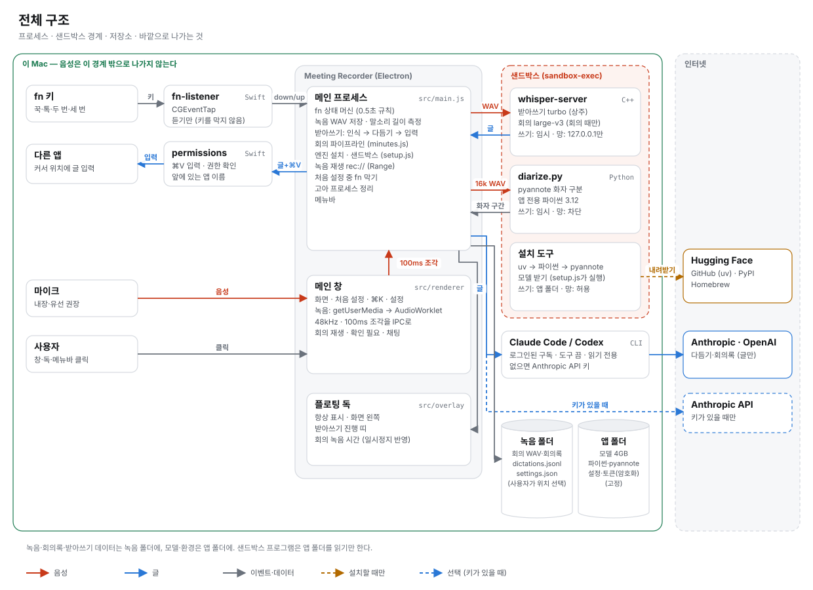
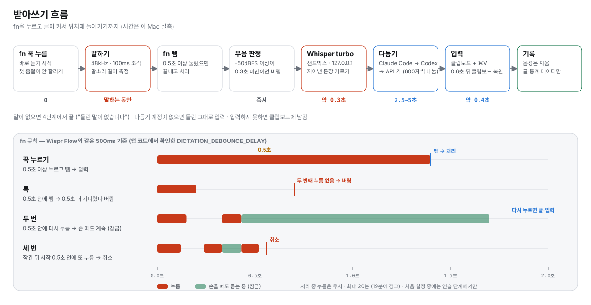
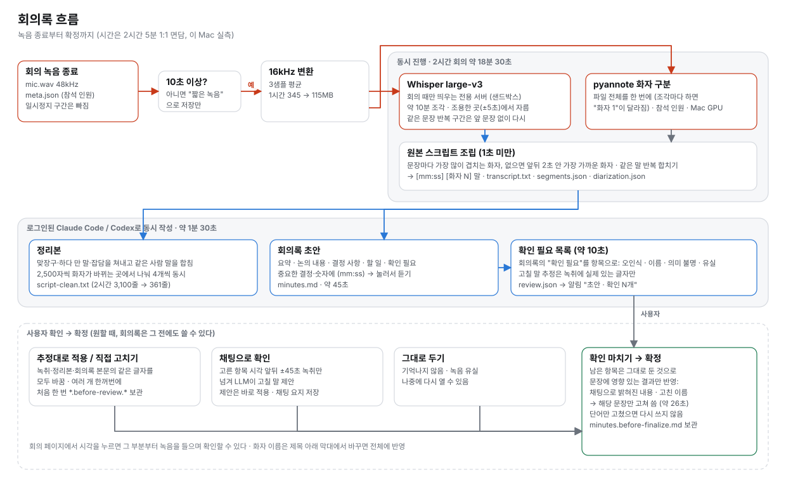

# Meeting Recorder (프로토타입)

macOS용 Electron 앱. 두 가지 일을 한다.

1. **받아쓰기**: Wispr Flow처럼 `fn`을 누른 채 말하면 다듬은 글이 지금 커서 위치에 들어간다. 음성은 변환에만 쓰고 지우며, 글과 통계용 데이터만 남긴다.
2. **오프라인 회의록**: 대면 회의를 맥 마이크로 녹음해 두면 녹취(Whisper large-v3) + 화자 구분(pyannote) → 대화 스크립트·정리본·회의록 초안을 만든다. 확인이 필요한 부분을 하나씩 처리한 뒤 회의록을 확정한다. 녹음·녹취·화자 구분은 이 Mac 안에서 하고 회의록 쓰기만 인터넷이 필요하다. 끊겨 있으면 녹취를 저장해 두고 연결되면 이어서 쓴다.

음성 인식과 화자 구분은 이 Mac 안에서 돌고(외부 프로그램은 샌드박스 안에서 실행), 다듬기·회의록 작성은 이미 로그인된 Claude Code / Codex 구독(없으면 Anthropic API 키)을 쓴다.

문서:
- [CHANGELOG.md](CHANGELOG.md) — 기능 추가·버그 수정 이력 (증상·원인·고침·확인)
- [docs/decisions.md](docs/decisions.md) — 왜 그렇게 만들었는지 (판단·트레이드오프)
- [docs/known-issues.md](docs/known-issues.md) — 알려진 한계·확인 못 한 것·남은 일
- [docs/research/wispr-flow.md](docs/research/wispr-flow.md) — Wispr Flow 앱 분석 기록
- [docs/measurements.md](docs/measurements.md) — 실측값 (속도·크기·정리본 줄 수·소리 크기)
- [docs/testing.md](docs/testing.md) — 셀프테스트·화면 캡처·샌드박스·고아 프로세스 점검·회의록 다시 돌리기 (`scripts/dev/`)

## 시작하기

앱 밖에서 직접 해야 하는 것은 이것뿐이다. 나머지(권한·엔진·모델·화자 구분·계정 확인·연습)는 앱의 **처음 설정** 화면에서 진행한다.

- [Homebrew](https://brew.sh) 설치 (음성 인식 엔진 whisper.cpp를 앱이 brew로 설치한다)
- Claude Code(`claude`) 또는 Codex(`codex login`) 로그인 — Anthropic API 키를 쓰면 생략
- 화자 구분을 쓰려면 Hugging Face에서 [pyannote 모델](https://huggingface.co/pyannote/speaker-diarization-community-1) 약관 동의 + Read 토큰 만들기 (토큰은 처음 설정에서 붙여 넣는다)

개발:
```bash
npm install
npm start            # 개발 모드 실행 (fn 감지 헬퍼 빌드 포함)
npm run selftest     # fn 꾹 누르기·탭·두 번·세 번 누르기, 처리 중 무시, 회의 중 fn 무시, 짧은 회의 녹음 검증
npm run test:ui      # 화면 테스트: 입력칸마다 진짜 키 입력(영어·Backspace), 오류 알림 글자 대비, 오래 걸리는 작업 중복 방지 (가짜 데이터, 약 20초)
npm run install-app  # .app 빌드 → 서명 → /Applications 설치
```
`npm run dist`(`install-app`도)는 빌드 전에 키보드 처리기 검사와 화면 테스트를 돌리고, 하나라도 실패하면 멈춘다 ([docs/testing.md](docs/testing.md)).
소스에서 빌드하려면 Node.js와 Xcode 명령줄 도구(swiftc)가 필요하다.

- **서명**: `sh scripts/dev/make-signing-cert.sh`를 한 번 돌려 두면 키체인의 자체 서명 인증서로 서명해서, 다시 빌드해도 macOS 권한(문서 폴더·마이크·입력 모니터링·손쉬운 사용)이 유지된다. 인증서가 없으면 ad-hoc으로 서명하고, 그러면 다시 빌드할 때마다 권한을 다시 허용해야 한다 (문서 폴더 권한이 풀리면 회의 목록이 비어 보인다).
- **다른 Mac에서 열기**: 어느 서명이든 Apple 공증을 받지 않아 "확인되지 않은 개발자"로 막힌다. 한 번 열어 본 뒤 시스템 설정 › 개인정보 보호 및 보안에서 "그래도 열기"를 누른다 (macOS 15부터는 우클릭 › 열기로는 안 된다).

## 아키텍처

선 색은 흐르는 것을 뜻한다: 주홍 음성 · 파랑 글 · 회색 이벤트·데이터 · 점선 설치할 때만/선택. 그림은 `docs/images/diagrams.py`로 만든다 (고친 뒤 `python3 docs/images/diagrams.py`).

### 전체 구조

<picture>
  <source media="(prefers-color-scheme: dark)" srcset="docs/images/architecture-dark.svg">
  
</picture>

음성은 이 Mac 밖으로 나가지 않는다. 바깥으로 나가는 것은 다듬기·회의록 작성에 쓰는 **글**(로그인된 Claude Code·Codex 또는 API 키)과 설치할 때의 내려받기뿐이다.

### 받아쓰기 흐름

<picture>
  <source media="(prefers-color-scheme: dark)" srcset="docs/images/dictation-flow-dark.svg">
  
</picture>

### 회의록 흐름

<picture>
  <source media="(prefers-color-scheme: dark)" srcset="docs/images/meeting-flow-dark.svg">
  
</picture>

## 처음 설정

앱을 처음 열면 본 화면 대신 처음 설정 화면이 뜨고, 끝내야 본 화면으로 넘어간다 (Wispr Flow 온보딩 구조를 참고: 본 창 안 전체 화면, 위에 단계 진행 표시). 진행 상황은 저장되어 앱을 다시 열면 그 단계부터 이어서 한다. 설정 › 받아쓰기 › 처음 설정 **다시 보기**로 다시 할 수 있다.

1. **시작**: 받아쓰기·회의록 소개 (둘 다 기본으로 켜져 있음), 개인정보 원칙
2. **권한**: 마이크 → 입력 모니터링 → 손쉬운 사용을 카드 하나씩. 1초마다, 그리고 시스템 설정에서 돌아올 때 다시 확인하고 허용되면 창을 앞으로 가져온다. 🌐 키 설정도 확인
3. **Hugging Face 토큰**: 약관·토큰 페이지 안내, 저장하면 바로 확인
4. **엔진 설치**: 들어오면 바로 설치 시작. 받아쓰기에 필요한 것(엔진·받아쓰기 모델)만 끝나면 넘어갈 수 있고 나머지는 뒤에서 계속 받는다
5. **다듬기 계정**: Claude Code·Codex 로그인 확인, 없으면 API 키
6. **마이크 확인**: 말하면 레벨 막대가 움직이는지, 블루투스 마이크 경고
7. **fn 키 확인**: 녹음하지 않고 누름만 확인 (키 그림이 주홍색으로)
8. **연습**: 예문을 실제 입력칸에 받아쓰기. 입력칸 클릭·꾹 누르기 안내, 15초 뒤 건너뛰기
9. **완료**

처음 설정 중에는 fn 받아쓰기가 연습 단계에서만 동작한다. 앱을 열 때는 처음 설정을 마쳤는지 먼저 확인한 뒤 창을 띄워, 본 화면이 잠깐 비쳤다가 바뀌지 않는다.

## 조작

| 조작 | 동작 |
|---|---|
| `fn` 꾹 누르기 (0.5초 이상) | 누르는 동안 녹음, 떼면 받아써서 커서 위치에 입력 |
| `fn` 짧게 톡 | 0.5초 기다렸다가 두 번째 누름이 없으면 버림 |
| `fn` 빠르게 두 번 | 손을 떼도 계속 듣기(잠금). 다음 `fn`에서 끝내고 입력 |
| `fn` 빠르게 세 번 | 취소 |
| `fn`+다른 키 | 녹음 버림 (단축키를 쓴 것으로 본다) |
| 회의 녹음 버튼 (창·독·메뉴바) | 시작 시트(참석 인원 · 대면/화상 · 회의록 자동) → 녹음. 녹음 중 **취소 · 일시정지/재개 · 종료하고 저장**, 참석 인원은 녹음 중에도 바꿀 수 있다 |
| `⌘K` / `⌘,` / `⌘[` `⌘]` | 빠른 검색 / 설정 / 뒤로·앞으로 (마우스 옆 버튼·트랙패드 넘기기도 됨) |

fn 규칙은 Wispr Flow 앱 코드에서 확인한 값을 따른다 (`DICTATION_DEBOUNCE_DELAY` 500ms, 받아쓰기 최대 20분·19분에 경고, 앞 받아쓰기를 처리하는 동안 fn은 무시하고 알림). 회의 녹음은 fn에 반응하지 않는다.

창의 X는 창만 숨긴다. 앱은 메뉴바와 화면 왼쪽 플로팅 독(항상 표시)으로 계속 실행되고, 종료는 메뉴바 › 종료 또는 ⌘Q. 패키징된 앱은 첫 실행 때 로그인 항목에 등록된다 (메뉴바에서 끌 수 있음).

## 화면

- **홈**: 오늘 받아쓴 글자·평균 WPM·연속 사용일, 확인할 문제(권한·엔진·토큰), 만들고 있는 회의록, 최근 회의·받아쓰기
- **받아쓰기**: 날짜별 기록, 검색, 다듬기가 지운 말(취소선)·넣은 말(밑줄) 표시, 복사·다시 입력·원문·삭제
- **회의**: 회의록 있는 회의는 카드("초안 · 확인 N개" / "확정"), 녹음만·실패·짧은 녹음은 한 줄로 접고 휴지통으로 옮길 수 있다 (폴더째, 한꺼번에도)
- **회의 페이지**: 녹음 재생(화자 색 띠, 말소리는 있는데 녹취 글이 없는 구간은 빗금, 스크립트 줄을 누르면 그 시각부터, 따라가기), 화자 이름 막대, 탭 — 회의록 / 확인 필요 / 액션(찾았을 때만) / 정리본 / 원본 / 화자, ⌘F 본문 찾기. 회의 폴더의 파일이 바뀌면(앱 밖에서 고쳐도) 화면을 다시 그린다. 지운 회의는 "삭제된 녹음입니다"
- **사전**: 자주 틀리는 이름·용어 목록 (받아쓰기와 회의 녹취에 모두 쓰임)
- **통계**: 최근 14일 글자 수, 앱별 사용량, 단계별 걸린 시간, 회의 녹음 시간
- **설정** (모달): 받아쓰기 · 다듬기 · 회의 · 엔진 · 계정·토큰 · 권한

## 받아쓰기

1. 말소리 크기(-50dBFS 이상)가 0.3초 미만이면 무음으로 보고 Whisper에 넘기지 않는다 (무음에서 "감사합니다"를 지어내는 문제 방지)
2. 로컬 Whisper(large-v3-turbo q8_0, 약 0.9GB)로 변환. `whisper-server`를 앱이 띄워 모델을 메모리에 올려 두므로 짧은 문장은 0.3초 안팎
3. Whisper가 무음·잡음에서 자주 지어내는 문장("감사합니다", "시청해 주셔서 감사합니다" 등)은 입력하지 않는다
4. (선택) 다듬기: 군말·자기 정정·띄어쓰기 정리 (`src/cleanup.js`)
   - 자동: Claude Code(`claude -p`, 약 2.5초) → Codex(`codex exec`, 약 3.5~5초) → Anthropic API 키(`claude-opus-5-5`, safeStorage 암호화 저장) 순으로 로그인된 것
   - 600자가 넘으면 문장 단위로 나눠 최대 4개를 동시에 다듬고 다시 잇는다. 실패한 조각은 원문 그대로 둔다
5. 클립보드에 넣고 ⌘V 입력 후 0.6초 뒤 원래 클립보드 복원. 입력하지 못하면 클립보드에 남긴다

## 회의록

회의 녹음을 멈추면 끝까지 자동으로 진행해 **초안**을 만든다 (설정 › 회의에서 끌 수 있음). 10초 미만 녹음은 회의록을 만들지 않고 "짧은 녹음"으로 남긴다.

| 단계 | 하는 일 | 2시간 회의 실측 |
|---|---|---|
| 1 | 48kHz WAV를 16kHz로 줄이고, 약 10분마다 조용한 지점에서 잘라 **Whisper large-v3**(회의 전용으로 따로 띄움)로 녹취. 같은 문장(또는 두세 문장을 번갈아)을 되풀이한 구간은 앞 문장을 참고하지 않고 그 구간만 다시 받아쓴다 | 녹취+화자 구분 약 18분 (반복 구간 다시 받아쓰기 포함) |
| 2 | 같은 시간에 **pyannote speaker-diarization-community-1**로 화자 구분 (파일 전체, Mac GPU, 참석 인원을 알려 주면 더 정확) | (동시) |
| 3 | 원본 스크립트 조립: 녹취 구간마다 가장 많이 겹치는(없으면 2초 안 가장 가까운) 화자를 붙이고 같은 말 반복은 합친다 → `[mm:ss] [화자 N] 말` | 1초 미만 |
| 4 | 정리본(맞장구·하다 만 말·잡담을 쳐내고 같은 사람의 이어진 말을 합침)과 회의록을 동시에 작성 | 약 1분 30초 |
| 5 | 회의록의 "확인 필요"를 항목별 목록으로 정리 | 약 10초 |

**확인 필요 → 확정**: 회의 페이지의 확인 필요 탭에서 항목마다(또는 여러 개 골라 한꺼번에)

- **추정대로 적용 / 고칠 말 직접 입력**: 녹취·정리본·회의록 본문에서 같은 글자를 모두 바꾼다 (처음 한 번 `*.before-review.*`로 원본 보관)
- **채팅으로 확인**: 고른 항목과 그 시각 앞뒤 녹취를 근거로 LLM이 고칠 말을 제안, 제안은 바로 적용
- **그대로 두기**: 기억나지 않거나 유실된 부분
- **처리함에서 다시 손보기**: 확인 마치기 전까지는 처리한 항목을 "고치기"(고친 말을 다른 말로)·"되돌리기"·"다시 열기"할 수 있다. 그 항목이 바꾼 줄만 원래대로 돌리고 다른 항목이 고친 줄은 그대로 둔다. 이 기능 전에 고친 단어는 `*.before-review.*` 보관본과 맞대어 바뀐 줄을 찾는다 (구간 다시 받아쓰기는 기록이 없으면 되돌릴 수 없다)
- **확인 마치기**: 남은 항목은 그대로 둔 것으로 하고, 채팅으로 밝혀진 내용·고친 이름처럼 문장에 영향이 있을 때만 회의록의 해당 문장을 고쳐 쓴다 (이전 회의록은 `minutes.before-finalize.md`). 단어만 고쳤다면 다시 쓰지 않는다

다른 앱에서 녹음한 파일(m4a·mp3·wav·aac·caf·aiff·flac 등)은 회의 화면의 "파일 가져오기"나 끌어다 놓기로 회의록을 만든다. 여러 개를 고르면 이름 순서대로 이어 붙여 회의 하나로 만들고, 파일 이름에 녹음 시각이 있으면("2026-11-04 오후 4.49.27" 등) 그 시각을 회의 시각으로 쓴다. 원본 파일은 그대로 둔다. 가져오기 전 확인 창에서 참석 인원과 "녹음에 담기지 않은 내용"(녹음을 끝낸 뒤 오간 말 등)을 적으면 회의록에 "(녹음 외 메모)"로 함께 들어간다.

회의 페이지에서 ⌘F를 누르면 지금 탭(회의록·정리본·원본 등)의 본문 안에서 찾는다.

확인 필요에서 오인식 단어·이름을 고치면 고친 말이 사전에 들어가 다음 녹음부터 더 잘 알아듣는다. 확인 필요의 유실 항목은 "구간 다시 받아쓰기"(또는 채팅에서 "다시 돌려 줘")로 그 구간만 녹음에서 다시 받아쓴다. 결과를 먼저 보여 주고, 반영하면 그 구간의 녹취 줄만 바뀐다.

회의록 아래 "액션 찾기"를 누르면(회의록을 만들 때 자동으로 만들지 않는다), 대화에서 누군가 하기로 한 일(약속·맡은 일·다짐)이나 남길 조언이 있을 때 "액션" 탭이 생긴다. 할 일은 카드 하나 안의 체크리스트(담당·기한·근거 시각, 진행 막대)로, 조언은 주제별 묶음과 핵심 ★로 보여 주고, 일하는 회의에서는 조언 칸을 "알아 둘 것"으로 부른다.

인수인계·업무 절차처럼 단계와 순서를 설명한 회의는 회의록 아래 "흐름도 만들기"로 그림을 만든다. 원본·정리본·회의록을 모두 보고 흐름을 최대 3장까지 그리며(띠·단계·메모·바뀐 경위·인수인계), 단계와 메모는 녹취 인용을 앱이 확인해 지어낸 것은 뺀다. 그림마다 채팅으로 고치거나 다시 만들거나 지울 수 있다.

회의록 아래 "용어" 칸과 본문 밑줄로 사내 용어·약어·기술 용어의 한 줄 설명을 본다. 회의록을 만들 때 LLM이 고르고, 회의 내용으로 추정한 설명은 "추정"으로 보여 줘 맞아요·고치기·지우기로 확인한다. 본문에서 단어를 드래그하면 설명을 더할 수 있다. 인터넷 검색은 하지 않는다.

화자 이름은 회의 페이지 제목 아래 막대(또는 스크립트의 화자 이름)를 눌러 바꾸면 스크립트·정리본·회의록·요약 전체에 보인다. 파일 안의 표시는 "화자 N" 그대로 두고 이름은 `meta.json`에 따로 저장해, 보여 줄 때만 "화자 N" 자리를 이름으로 바꾸고 조사(은/는·이/가 등)를 받침에 맞춘다. 회의록을 다시 만들면 화자 번호가 바뀔 수 있어 이름이 지워진다.

## 엔진 (설정 › 엔진)

구성요소마다 설치 상태·크기를 보고 받거나 지운다. 처음 설정의 엔진 단계도 같은 기능을 쓴다.

| 구성요소 | 설치 방법 | 크기 |
|---|---|---|
| 음성 인식 엔진 (whisper.cpp) | 앱이 `brew install whisper-cpp` 실행 (Homebrew는 먼저 설치) | |
| 받아쓰기 모델 (large-v3-turbo q8_0) | 앱이 내려받음 | 0.9GB |
| 회의 모델 (large-v3, 없으면 turbo로 녹취) | 앱이 내려받음 | 3.1GB |
| 화자 구분 (pyannote) | 샌드박스 안에서 uv → 앱 전용 파이썬 3.12 → `pyannote.audio==4.0.7` → 모델(33MB) 순으로 설치, 끝나면 내려받기 캐시를 지운다 | 약 1.2GB |

모델·화자 구분 환경은 모두 `~/Library/Application Support/meeting-recorder/` 안에 둔다 (Hugging Face 기본 캐시 `~/.cache/huggingface`를 쓰지 않는다. 토큰만 `hf auth login` 위치에서 읽는다).

## 샌드박스

앱이 띄우는 외부 프로그램은 macOS 샌드박스(Seatbelt, `sandbox-exec`)로 감싼다 (`src/sandbox.js`, Codex·Claude Code와 같은 방식). 읽기는 넓게 두고 쓰기·네트워크를 좁힌다.

| 프로그램 | 쓸 수 있는 곳 | 네트워크 |
|---|---|---|
| 화자 구분 설치 (uv·pip·모델 받기) | 앱 폴더 + 임시 폴더 | 허용 |
| 화자 구분 실행 | 임시 폴더 | 차단 (`HF_HUB_OFFLINE`) |
| whisper-server (받아쓰기·회의 녹취) | 임시 폴더 | 127.0.0.1만 |

Homebrew 설치, Claude Code·Codex 호출(자체 샌드박스·읽기 전용), 앱 본체(fn 감지·⌘V 입력)는 샌드박스 밖에서 실행된다. 앱 전체를 App Sandbox에 넣지 않는 이유는 fn 감지·다른 앱 입력·외부 CLI 실행이 막히기 때문이다.

앱이 띄운 도우미(whisper-server, fn-listener)는 앱이 끝날 때 함께 내리고, 강제 종료·크래시로 남은 고아 프로세스는 다음 시작 때 정리한다.

## 저장 위치

녹음 폴더 기본값은 `~/Documents/MeetingRecorder/`. 설정 › 받아쓰기 › 녹음 폴더에서 **변경…**으로 다른 폴더(외장 디스크 등)를 고를 수 있다. 고를 때 기존 녹음을 옮길지 정하고, 같은 이름이 있으면 덮어쓰지 않는다. 지정한 폴더가 없으면(디스크 분리 등) 기본 폴더를 쓴다.

- 회의 `<날짜>_meeting/`: `mic.wav`(+ 화상 회의면 `system.wav`), `meta.json`(참석 인원·바꾼 화자 이름, 가져온 녹음이면 원래 파일 이름과 이어 붙인 위치 `imported`·녹음 외 메모 `notes` 포함), `transcript.txt`(원본 스크립트), `script-clean.txt`(정리본), `minutes.md`(회의록), `minutes.json`(상태), `review.json`(확인 필요 항목·처리 결과·채팅 요지), `glossary.json`(용어 설명), `flow.json`(흐름도), `actions.json`(액션: 할 일·조언), `segments.json`(녹취 구간, 같은 문장 반복으로 다시 받아쓴 구간 `redo`)·`diarization.json`(화자 구간)
- `settings.json`: 사전과 일반 설정(언어·다듬기 계정·회의록 자동 등, 토큰·키는 제외)의 사본. 녹음 폴더만 다른 컴퓨터로 옮겨도 이어 쓸 수 있다. 앱 설정이 비어 있으면(새 컴퓨터) 그대로 가져오고, 아니면 사전 단어만 합친다
- `dictations.jsonl`: 받아쓰기 한 건마다 한 줄 (시각, 길이, 실제 말소리 길이, 입력한 앱, 정리 전/후 글, 글자·단어 수, WPM, 다듬기 계정, 단계별 소요 시간). 음성은 임시 폴더에 녹음해 변환 후 바로 지운다

앱 데이터는 `~/Library/Application Support/meeting-recorder/`: 설정(`dictation.json`, 토큰은 키체인으로 암호화), 모델(`models/`), 화자 구분 환경(`diarize-env/`, `python/`, `bin/uv`), 화자 구분 모델(`hf-cache/`).

## 필요한 macOS 권한 (설치한 앱은 Meeting Recorder에, 개발 모드는 터미널 앱에 부여)
- 마이크
- 입력 모니터링: fn 키 감지 (`native/fn-listener`)
- 손쉬운 사용: 받아쓴 글을 ⌘V로 입력 (`native/permissions paste`)
- 화면 및 시스템 오디오 녹음 › 시스템 오디오 녹음 전용: 화상 회의로 녹음할 때만
- 키보드 설정 "🌐 키를 누르면" → "아무것도 안 함"

## 구조
- `src/main.js`: fn 상태 머신(받아쓰기 전용, 처음 설정 중 막기), 회의 일시정지·취소·참석 인원, WAV 저장, 녹음 폴더·설정 사본, 회의 녹음 재생용 `rec://` 프로토콜(Range 지원), 메뉴바·플로팅 독
- `src/setup.js`: 엔진 설치·크기·삭제 (설정 › 엔진, 처음 설정)
- `src/sandbox.js`: 외부 프로그램을 감싸는 macOS 샌드박스 프로필
- `src/dictation.js`: whisper-server 관리(고아 정리 포함), 모델 다운로드, 무음·지어낸 문장 거르기, 붙여 넣기
- `src/cleanup.js`: 다듬기·회의록 작성 호출 (Claude Code / Codex / API, 긴 글 나누기)
- `src/import-audio.js`: 녹음 파일 가져오기 (afconvert로 16비트 모노 WAV, 여러 개면 이름 순서대로 이어 붙임)
- `src/actions.js`: 액션 (할 일·조언을 LLM이 뽑고 녹취 인용으로 확인)
- `src/flow.js`: 흐름도 (요청할 때 원본·정리본·회의록으로 흐름을 뽑고 녹취 인용으로 검증, 그림마다 채팅·다시 만들기)
- `src/glossary.js`: 용어 설명 (LLM이 고르기·한 단어 설명·확인·고치기)
- `src/minutes.js`: 회의 녹취(같은 문장 반복 구간 다시 받아쓰기) + 화자 구분 → 스크립트·정리본·회의록, 확인 필요(목록·적용·채팅·확인 마치기), 화자 이름 표시
- `native/fn-listener.swift`: CGEventTap(listen-only)으로 fn down/up을 stdout으로 출력
- `native/permissions.swift`: 권한 확인·요청, ⌘V 입력, 앞에 있는 앱 이름
- `native/diarize.py`: pyannote 화자 구분 (앱 전용 파이썬 환경에서 실행)
- `src/renderer/`: 메인 창 (홈 · 받아쓰기 · 회의 · 사전 · 통계 · 설정 · ⌘K). Pretendard 글꼴(OFL) 포함. 디자인 규칙은 `DESIGN.md`
- `src/renderer/onboarding.js`: 처음 설정 화면
- `src/renderer/recorder.js`, `recorder-worklet.js`: getUserMedia + getDisplayMedia → AudioContext(48kHz) → 트랙별 100ms 청크
- `src/overlay/`: 화면 왼쪽 플로팅 독 (받아쓰기 진행 띠, 회의 녹음 시간)
- `src/wav-writer.js`: 스트리밍 기록, 5초마다 헤더 갱신(크래시 대비)
- `scripts/sign-app.sh`: 빌드한 앱 서명 (자체 서명 인증서가 있으면 그걸로, 없으면 ad-hoc)
- `scripts/dev/`: 개발용 — 서명 인증서 만들기, 키보드 처리기 검사(`check-handlers.js`), 화면 테스트(`ui-test.js`), 화면 캡처, 샌드박스 확인, 고아 프로세스 점검, 회의 사본에 회의록 다시 돌리기 ([docs/testing.md](docs/testing.md))
- `docs/images/diagrams.py`: README 아키텍처 그림(SVG) 생성기
